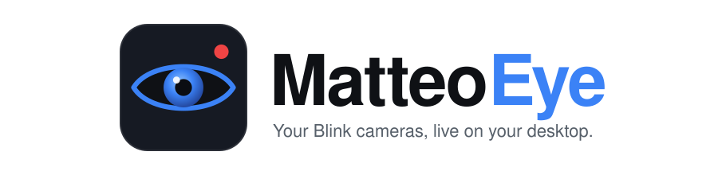
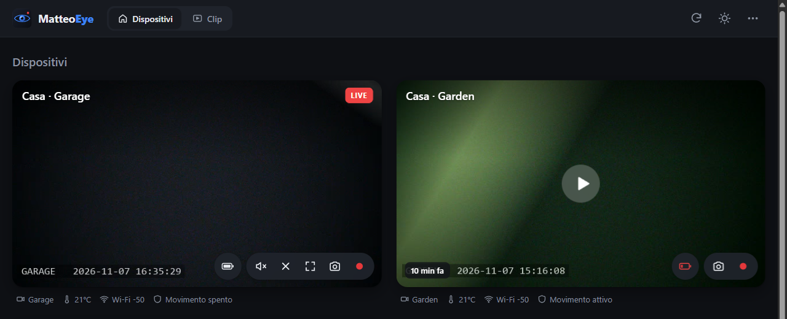
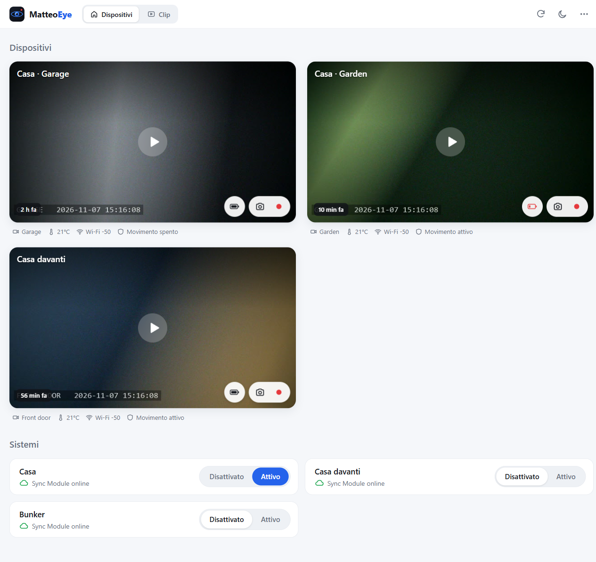
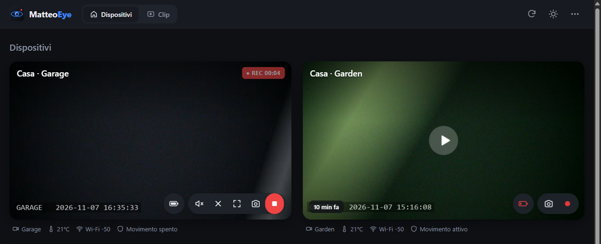
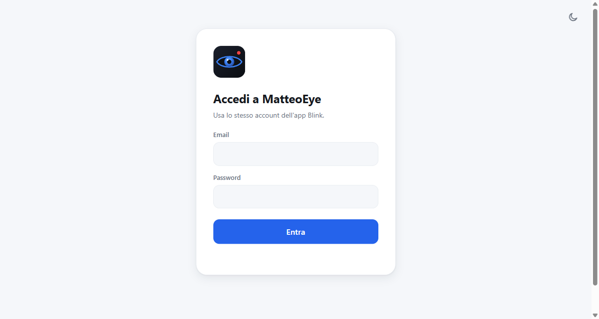
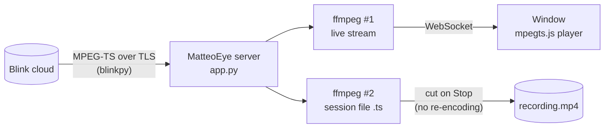

<p align="center">
  <picture>
    <source media="(prefers-color-scheme: dark)" srcset="docs/images/banner-dark.svg">
    
  </picture>
</p>

<p align="center">
  <b>Watch and record your Blink cameras from your Windows PC or Mac.</b><br>
  Live video in a native window, one-click recording to MP4, no browser and no cloud server of your own.
</p>

<p align="center">
  <a href="https://github.com/markmanny/matteoeye/releases/latest"></a>
  <a href="https://github.com/markmanny/matteoeye/actions/workflows/tests.yml"></a>
  
  
  <a href="https://github.com/fronzbot/blinkpy"></a>
</p>

<p align="center">
  <a href="#download">Download</a> ·
  <a href="#features">Features</a> ·
  <a href="#how-it-works">How it works</a> ·
  <a href="#run-from-source">Run from source</a> ·
  <a href="#faq">FAQ</a> ·
  <a href="README.it.md">🇮🇹 Italiano</a>
</p>

<p align="center">
  
</p>

> **MatteoEye is an independent open-source project.** It is not affiliated with, endorsed by or sponsored by Blink or Amazon. It talks to Blink through the same unofficial API used by Home Assistant.

## Download

Grab the latest package from the **[Releases page](https://github.com/markmanny/matteoeye/releases/latest)**. Nothing else to install: Python and ffmpeg are bundled.

| System | File | How to start |
| --- | --- | --- |
| **Windows 10 / 11** | `MatteoEye.per.Windows.zip` | Extract the zip (right-click, *Extract all*), then double-click `Avvia MatteoEye.bat` |
| **macOS, Apple silicon** (M1 and later) | `MatteoEye.per.Mac.zip` | Extract, then open `MatteoEye` |
| **macOS, Intel** | `MatteoEye.per.Mac.zip` | Extract, then open `MatteoEye (Mac Intel)` |

The app is not signed by a registered developer yet, so the first launch shows a warning:

- **Windows**: in the *Windows protected your PC* dialog click **More info → Run anyway**.
- **macOS**: open **System Settings → Privacy & Security**, scroll down and click **Open Anyway** next to MatteoEye.

Then sign in with your Blink email and password and enter the code Blink sends you by SMS or email. You only do this once per computer.

## Features

- **Live view in seconds.** Video starts from the first keyframe, usually 7 to 20 seconds after the click. Most of that is Blink waking up a battery camera.
- **One-click recording.** The red **●** button saves what the camera sees to an `.mp4`; a `REC mm:ss` badge shows how long you have been recording. When you stop, a *Save as* dialog lets you choose where; otherwise it lands in `Videos/MatteoEye` (Windows) or `Movies/MatteoEye` (macOS). If Blink ends the live view on its own, the recording is still saved.
- **Every camera at a glance.** Thumbnails, battery, temperature and arm status for all your cameras.
- **One tab per place.** Each network (Sync Module) gets its own tab, so you only see the cameras of that house or office. The bar at the bottom arms or disarms the whole network, like in the Blink app, and the shield under each card toggles its motion detection.
- **Fresh snapshots.** The camera button asks for a new thumbnail; the badge in the corner tells you how old the picture is.
- **Fullscreen** and **audio** from the controls that appear while live; `Esc` leaves fullscreen. Dark theme by default, light theme one click away.
- **Native window.** WebView2 on Windows and WebKit on macOS. If the window cannot open, it falls back to your browser.
- **Private by design.** Only Blink's access tokens are stored, never your password. Everything runs on your computer and no third-party server sees your video.
- **Optional remote access** from phones and other PCs over your home network, [Tailscale](https://tailscale.com) or [ngrok](https://ngrok.com) (macOS launchers, see [the Italian guide](docs/it/accesso-remoto.txt)).

<table>
  <tr>
    <td width="50%"></td>
    <td width="50%"></td>
  </tr>
  <tr>
    <td align="center"><sub>All your cameras with live status</sub></td>
    <td align="center"><sub>Recording a live view to MP4</sub></td>
  </tr>
  <tr>
    <td colspan="2"></td>
  </tr>
  <tr>
    <td colspan="2" align="center"><sub>Sign in once with your Blink account (two-factor code included)</sub></td>
  </tr>
</table>

<sub>Screenshots use simulated cameras from the test suite. The interface is currently in Italian.</sub>

## How it works

MatteoEye is a small local web app (FastAPI) wrapped in a native window. It listens on `127.0.0.1:8787` only, unless you start it with `--lan`.



1. It asks Blink to start a live view and connects to the video server Blink points to.
2. The MPEG-TS packets go to two ffmpeg processes. One feeds the window over a WebSocket, played by [`mpegts.js`](https://github.com/xqq/mpegts.js). The other writes the whole session to a temporary file.
3. When you stop a recording, the recorded span is cut from the session file into an `.mp4` without re-encoding, so it is fast and lossless.

The page sends a heartbeat every 15 seconds, and the app shuts itself down a few minutes after the last window closes.

## Run from source

You need Python 3.11 or newer and nothing else (ffmpeg comes from `imageio-ffmpeg`).

```bash
git clone https://github.com/markmanny/matteoeye.git
cd matteoeye
python3 -m venv .venv
./.venv/bin/pip install -r requirements.txt pywebview   # Windows: .venv\Scripts\pip
```

```bash
./.venv/bin/python app.py --app      # desktop mode: own window, data in the user folder
./.venv/bin/python app.py            # browser only, data next to app.py
./.venv/bin/python app.py --lan      # also reachable from other devices at home
```

On macOS you can also double-click the launchers in [`scripts/macos/`](scripts/macos).

| Option | Effect |
| --- | --- |
| `--app` | Desktop mode: native window, data and log in the user folder, quits when the window closes |
| `--browser` | With `--app`, use the default browser instead of the native window |
| `--lan` | Listen on all interfaces (`0.0.0.0`) so phones and other PCs can connect |
| `--port N` | Use port `N` instead of `8787` |
| `BLINKLIVE_DATA` | Environment variable: folder for tokens and log |

## Project structure

```text
matteoeye/
├── app.py                  # the whole server: Blink login, live view, recording, window
├── static/
│   ├── index.html          # the single-page interface
│   └── mpegts.js           # MPEG-TS player for the browser/WebView
├── tests/                  # end-to-end tests with a simulated Blink camera
├── packaging/              # build scripts for the Windows and macOS packages
├── scripts/macos/          # double-click launchers (local, LAN/Tailscale, ngrok)
├── docs/
│   ├── images/             # logo, banner and screenshots
│   └── it/                 # Italian guides
└── requirements.txt
```

## Tests

The tests use a simulated camera (ffmpeg generates a test video), so you need neither real cameras nor a Blink account.

```bash
./.venv/bin/python tests/test_ws.py        # live stream over WebSocket + recording, against the real server
./.venv/bin/python tests/test_webview.py   # playback in a WebKit window (like the macOS app)
./.venv/bin/python tests/test_chrome.py    # playback in headless Chrome (the engine behind WebView2)
```

`test_ws.py` runs on every push via [GitHub Actions](.github/workflows/tests.yml).

## Building the packages

From a Mac with Python 3.13 from python.org:

```bash
packaging/build-macos.sh     # dist/MatteoEye per Mac.zip  (Apple silicon + Intel via Rosetta)
packaging/build-windows.sh   # dist/MatteoEye per Windows.zip (embeddable Python + Windows wheels)
```

Then attach both zips to a new [GitHub Release](https://github.com/markmanny/matteoeye/releases/new).

## FAQ

<details>
<summary><b>Where are my credentials stored?</b></summary>

Only Blink's access tokens are saved, never your password, in `%APPDATA%\MatteoEye` on Windows and `~/Library/Application Support/MatteoEye` on macOS, together with the log file `blinklive.log`. **Esci** (log out) deletes them.
</details>

<details>
<summary><b>The live view stops after a few minutes</b></summary>

Battery cameras end live views on their own, just like in the Blink app. Press the play button again. Each live view uses camera battery.
</details>

<details>
<summary><b>"Camera is offline" or "System is busy"</b></summary>

These messages come from Blink: the camera is off or Blink's servers are busy. They are not MatteoEye errors. Try again in a few seconds.
</details>

<details>
<summary><b>The window opens in my browser instead</b></summary>

On Windows the native window needs the WebView2 runtime, which ships with Windows 10 and 11. If it is missing, MatteoEye opens your browser instead and works the same. The log file tells you why.
</details>

<details>
<summary><b>Blink changed something and login or live view broke</b></summary>

The Blink API is unofficial and can change. Update the library with `pip install -U blinkpy` and open an [issue](https://github.com/markmanny/matteoeye/issues) with your `blinklive.log`. Remove your email from the log before you share it.
</details>

## Contributing

Bug reports, ideas and pull requests are welcome. See [CONTRIBUTING.md](CONTRIBUTING.md). For security issues, see [SECURITY.md](SECURITY.md).

## Acknowledgements

- [blinkpy](https://github.com/fronzbot/blinkpy), the Python library behind Home Assistant's Blink integration
- [mpegts.js](https://github.com/xqq/mpegts.js) for in-page MPEG-TS playback
- [FastAPI](https://fastapi.tiangolo.com), [pywebview](https://pywebview.flowrl.com) and [ffmpeg](https://ffmpeg.org) via [imageio-ffmpeg](https://github.com/imageio/imageio-ffmpeg)
